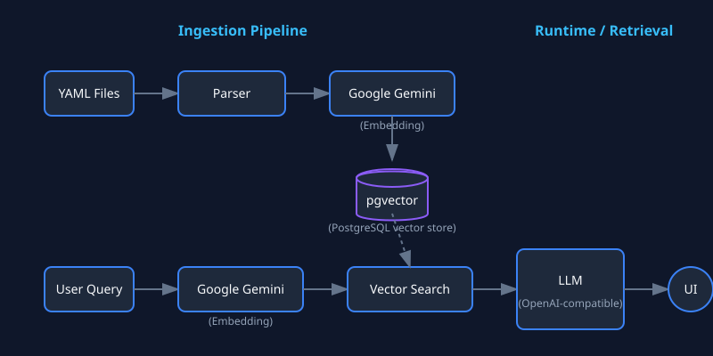

# Personal Intelligence App: RAG-based Chatbot

A personal intelligence engine that turns your portfolio and experience into an interactive, context-aware conversational agent. It answers in first person about background, projects, and experience, grounded strictly in a YAML knowledge base.

## Tech Stack

- **Framework**: [Next.js 16](https://nextjs.org/) (App Router)
- **Language**: TypeScript
- **Styling**: [Tailwind CSS v4](https://tailwindcss.com/)
- **AI Models**:
  - **LLM**: `gemma4:31b` on Ollama Cloud by default; any [OpenAI-compatible](https://platform.openai.com/docs/api-reference) provider works (`LLM_BASE_URL` / `LLM_API_KEY` / `LLM_MODEL`)
  - **Embeddings**: [Google Generative AI](https://ai.google.dev/) (`gemini-embedding-001`, 3072 dimensions)
- **Vector Database**: [PostgreSQL](https://www.postgresql.org/) with [pgvector](https://github.com/pgvector/pgvector) (exact cosine scan + `tsvector` lexical search)
- **Streaming**: [Vercel AI SDK](https://sdk.vercel.ai/)

## System Architecture

The application follows a RAG (Retrieval-Augmented Generation) pipeline:



Top lane: safe ingestion (YAML → validate everything → entry chunks → Gemini 3072-d → staging table → atomic swap).
Bottom lane: request path (UI → guard → deterministic query prep → intent mode → query embedding → vector retrieval → grounded LLM stream → Markdown + optional rich visual).

## How It Works

1. **Knowledge base** (`career_brain/`): the single source of truth for the chatbot *and* the CVs.
   - `roles/` — one file per role (TaqaTechno Odoo, TaqaTechno Angular fintech contract, freelance, Code Alpha, New Start Egypt).
   - `projects/` — 7 flagship projects (Taqat Admin + Merchant panels, Translate Dashboard, Apiary and Honey, Relief Center, Emdad, this chatbot), the Odoo SaaS module, and `other-projects.yml`.
   - `facts/` — profile, skills (each with evidence paths), certifications, writing, GitHub activity, open source, CV links, contact, socials, photos.
   - Facts are sourced (portfolio, Odoo Apps store, GitHub API and commit history, CVs). Unconfirmed details are stored as `unknowns` / `url_status` fields that the prompt respects. Private repositories are cited by commit counts, never by link.

2. **Ingestion** (`npm run ingest:pg`, `scripts/ingest_pgvector.ts` + `scripts/kb-load.ts`):
   - Every file is decoded (UTF-8, UTF-8 BOM, UTF-16 LE/BE), parsed and validated **before the database is touched**; any error aborts with the live table untouched.
   - One chunk per logical entry with field labels and a meaningful label ("Frontend Angular Developer — TaqaTechno (roles)"); entries up to `CHUNK_SIZE=2000` stay whole.
   - All embeddings are computed up front, written to a staging table, row-count checked, then swapped in **atomically in one transaction**. Readers never see an empty or partial table.
   - `npm run ingest:pg -- --dry-run` prints the chunks without embedding or writing. Current size: 27 files → 40 chunks.

3. **Retrieval** (`lib/query.ts` → `lib/intent.ts` → `lib/pipeline.ts` → `database/pgvector.ts`):
   - Deterministic query prep (zero LLM calls) merges follow-ups: bare (`and`), continuations (`and his skills?`), referential (`the bee one`) and deictic (`what stack did you use there?`).
   - Intent picks a mode: focused top-8, expanded top-12 for explanations, or **complete** mode that loads every record of a category (all roles, all projects, all skills) with a backend-measured coverage note.
   - Exact pgvector cosine scan (no ANN index: pgvector ANN caps at 2000 dims, embeddings are 3072), at most 3 chunks per source. A hybrid mode (`RETRIEVAL_SEARCH=hybrid`, OR-ed full-text terms fused by RRF) exists but measured lower, so vector is the default.

4. **Generation** (`app/api/chat/route.ts` → `lib/generate.ts`):
   - Request guard (`lib/api-guard.ts`): role checks, length caps, per-IP rate limit. Long assistant turns echoed back as history are compacted (visual JSON stripped, truncated) instead of rejected.
   - System prompt: first person as Islam, visitor's language, complete answers, employers only from role records, no invented facts/links/numbers, off-topic and salary declined, injection resistant.
   - Output: complete Markdown first, then at most one `rich-ui` block (project cards, timeline, tech badges, comparison, diagram, details).

5. **UI** (`app/page.tsx`, `components/`): portfolio hero with CV downloads and suggestion chips; streaming prose with skeletons for arriving visuals; robust parser (accepts `rich-ui`/`json` fences, per-field validation, https-only links); stop / retry / new chat / copy; stick-to-bottom scrolling; layered SVG diagrams; light/dark themes; keyboard and screen-reader friendly; honours `prefers-reduced-motion`.

## Configuration (`.env`)

Required variables are validated at startup (`lib/env.ts`) and the app refuses to boot without them.
Copy `.env.example` to `.env` — the names match the code 1:1.

```
DATABASE_URL               # Postgres connection string
ASTRA_DB_COLLECTION        # pgvector table name (must be a plain SQL identifier)
GOOGLE_API_KEY             # Gemini embeddings key
EMBEDDING_MODEL            # e.g. gemini-embedding-001
RETRIEVAL_LIMIT            # chunks per answer (8)
LLM_BASE_URL               # Ollama Cloud: https://ollama.com/v1
LLM_API_KEY                # key from https://ollama.com/settings/keys
LLM_MODEL                  # gemma4:31b (measured best on the free tier)
LLM_MAX_TOKENS             # output cap
LLM_MAX_HISTORY_TURNS      # conversation turns sent to the LLM
LLM_TEMPERATURE            # sampling temperature
```

Optional (defaults shown):

```
MAX_MESSAGE_CHARS=2000    # longest single message accepted by /api/chat
MAX_MESSAGES=30           # longest conversation accepted per request
MAX_HISTORY_CHARS=12000   # longest total history accepted per request
RATE_LIMIT_PER_MIN=20     # per-IP requests/minute (in-memory; use shared storage for serverless)
LLM_DISABLE_THINKING=false # true for reasoning models whose thinking tokens would starve the answer budget
CHUNK_SIZE=2000           # ingestion safety-net split size (entries are rarely this large)
INGEST_MIN_CHUNKS=10      # refuse to swap in a suspiciously small corpus
RETRIEVAL_SEARCH=vector   # vector (default, measured best) | hybrid
CONTEXT_BUDGET_CHARS=24000 # complete-mode context budget
CHUNK_OVERLAP=200
```

## Commands

```
npm run dev                     # local UI
npm run ingest:pg               # rebuild the knowledge base (validated, atomic swap)
npm run ingest:pg -- --dry-run  # show chunks, no embeddings, no DB writes
npm test                        # unit tests (vitest)
npm run eval:retrieve           # Recall@1/@3/@8 + hit-rate gate (RETRIEVAL_SEARCH / EVAL_SEARCH)
npm run eval:answer             # real LLM answers: key facts, declines, forbidden content
npm run test:latency            # stage-by-stage latency benchmark
npm run build / start           # production build / serve
```

Questions worth asking the bot are listed in `questions.txt`.

## CVs

`resumes/islam-hafez-frontend.tex` and `resumes/islam-hafez-odoo.tex` share `resumes/cv-style.tex`: single column, standard headings, selectable text and no icon fonts (ATS friendly). Every line is sourced from `career_brain/`. Build with `pdflatex` (TeX Live / MiKTeX) or `tectonic` from inside `resumes/`, then copy the PDFs to `public/files/` for the download buttons.

## Evaluation

49 scenarios in `scripts/eval/scenarios.ts` (40 KB-backed, 9 decline/conversational), including traps for earlier hallucinations: testimonial companies listed as employers, an invented chatbot stack, wrong contract dates, answering off-topic trivia. A unit test fails if any expected source file is missing, so the eval can't go stale.

Measured on 2026-10-29 with real Gemini embeddings:

| | Result |
|---|---|
| Retrieval, vector (default) | R@1 0.764 · R@3 0.860 · **R@8 0.993**, gate passed |
| Retrieval, hybrid | R@8 0.968, gate failed (missed one scenario) |

Answer eval, same 48 graded scenarios, Ollama Cloud free tier:

| Model | Passed | Avg generation |
|---|---|---|
| **gemma4:31b** (default, final prompt) | **48/48** | **~1.2 s** |
| beam | 47/48 | ~4.7 s |
| gpt-oss:120b | 45/48 | ~2.6 s |
| nemotron-3-super | 45/48 | ~3.3 s |

The comparison ran on the prompt before its last revision; gemma4:31b scored 46–47/48 then, and 48/48 on the final prompt. Larger cloud models (kimi, glm, deepseek, minimax, mistral-large) need paid credits and were not compared.
